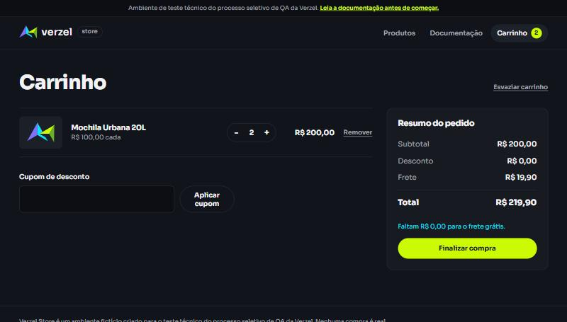
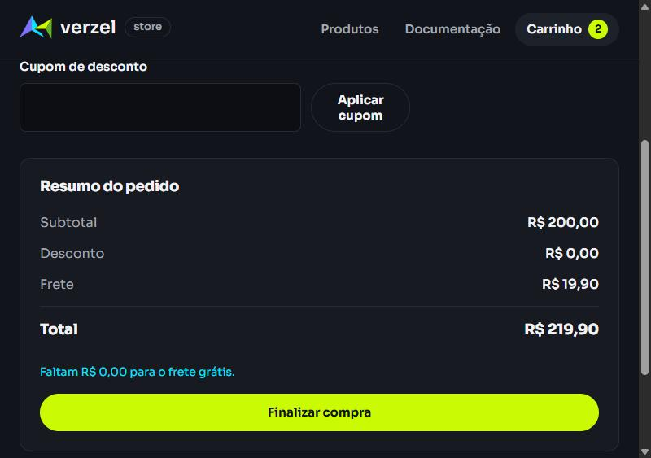
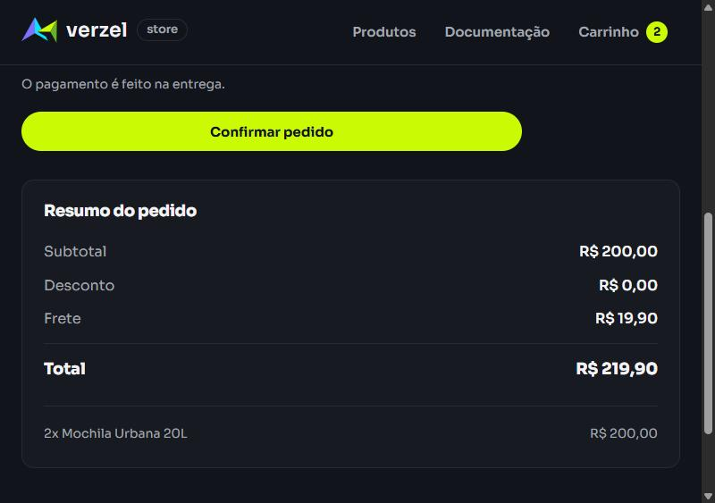
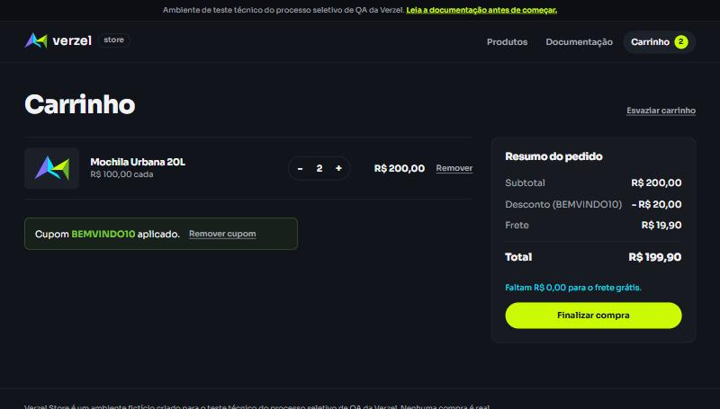

# BUG-01 — Frete de R$ 19,90 é cobrado quando o subtotal é exatamente R$ 200,00

| Campo | Valor |
|---|---|
| **Card** | VZS-142 — Cupom de desconto e frete grátis (versão 2.3.0) |
| **Severidade** | Alta |
| **Prioridade** | Alta |
| **Componente** | API (cálculo do frete); o erro aparece também no carrinho, no checkout e no pedido confirmado |
| **Critério violado** | CA06: "O frete é grátis para compras com subtotal a partir de R$ 200,00, inclusive." |
| **Cenário de teste** | CT06, linha do subtotal R$ 200,00 ([02-frete.feature](../cenarios/02-frete.feature)) |
| **Ambiente** | https://verzel-store.qa-test-verzel-store.workers.dev/ |
| **Data** | 09/10/2026 |
| **Status** | Aberto |

## Resumo

Quando o subtotal é exatamente R$ 200,00, a loja cobra o frete de R$ 19,90 em vez de dar frete grátis.

A própria resposta da API fica contraditória nesse caso:
- `valorFaltanteFreteGratis` vem `0`, indicando que não falta nada;
- `freteGratis` vem `false` e `frete` vem `19.9`.

Na tela, isso aparece como **"Faltam R$ 0,00 para o frete grátis."** com o frete cobrado ao lado.

## Pré-condições

Carrinho vazio, em uma aba nova do navegador.

## Passos para reproduzir (interface)

1. Acessar a loja.
2. Clicar 2 vezes em **Adicionar ao carrinho** na **Mochila Urbana 20L** (R$ 100,00).
3. Abrir o **Carrinho**.
4. Observar o resumo do pedido.

## Resultado esperado

| Subtotal | Desconto | Frete | Total | Mensagem de valor faltante |
|---|---|---|---|---|
| R$ 200,00 | R$ 0,00 | **Grátis** | **R$ 200,00** | não exibida |

## Resultado obtido

| Subtotal | Desconto | Frete | Total | Mensagem de valor faltante |
|---|---|---|---|---|
| R$ 200,00 | R$ 0,00 | **R$ 19,90** | **R$ 219,90** | **"Faltam R$ 0,00 para o frete grátis."** |

## Reprodução pela API

```bash
curl -X POST https://verzel-store.qa-test-verzel-store.workers.dev/api/carrinho/calcular \
  -H "Content-Type: application/json" \
  -d '{"itens":[{"produtoId":"P005","quantidade":2}]}'
```

Trecho da resposta (status 200):

```json
"subtotal": 200,
"frete": 19.9,
"freteGratis": false,
"valorFaltanteFreteGratis": 0,
"total": 219.9
```

Esperado: `"frete": 0`, `"freteGratis": true` e `"total": 200`.

## Abrangência

| Situação | Subtotal | Frete obtido | Frete esperado | Resultado |
|---|---|---|---|---|
| 2x Mochila Urbana 20L | R$ 200,00 | R$ 19,90 | Grátis | ❌ Falha |
| 4x Garrafa Térmica 750ml | R$ 200,00 | R$ 19,90 | Grátis | ❌ Falha |
| 2x Mochila + cupom BEMVINDO10 | R$ 200,00 | R$ 19,90 (total R$ 199,90) | Grátis (total R$ 180,00) | ❌ Falha |
| `POST /api/pedidos` com 2x Mochila | R$ 200,00 | R$ 19,90 (pedido criado com status 201) | Grátis | ❌ Falha |
| Controle: 1x Camiseta + 5x Kit Meias | R$ 209,40 | Grátis | Grátis | ✅ Correto |
| Controle: Mochila + Garrafa + Boné | R$ 199,90 | R$ 19,90 | R$ 19,90 | ✅ Correto |

Conclusões:
- O problema acontece com qualquer carrinho que some exatamente R$ 200,00, com ou sem cupom.
- Acima do limite a regra funciona, então o defeito está isolado no valor exato da fronteira.
- O pedido é confirmado com o frete cobrado, ou seja, o cliente paga R$ 19,90 a mais.

## Evidências

### Interface

**Carrinho com subtotal de R$ 200,00:** frete R$ 19,90, total R$ 219,90 e a mensagem "Faltam R$ 0,00 para o frete grátis.".



**Detalhe do resumo do pedido:**



**Checkout com o mesmo carrinho:** o frete cobrado chega à finalização da compra.



**Com o cupom BEMVINDO10:** total R$ 199,90, ainda com frete de R$ 19,90.



**Controle com subtotal de R$ 209,40:** frete grátis, como esperado.


### API

| Arquivo | Conteúdo |
|---|---|
| [BUG-01_calcular_subtotal-200_mochila.json](../evidencias/api/BUG-01_calcular_subtotal-200_mochila.json) | Cálculo com 2x Mochila |
| [BUG-01_calcular_subtotal-200_garrafa.json](../evidencias/api/BUG-01_calcular_subtotal-200_garrafa.json) | Cálculo com 4x Garrafa |
| [BUG-01_calcular_subtotal-200_com-cupom.json](../evidencias/api/BUG-01_calcular_subtotal-200_com-cupom.json) | Cálculo com cupom |
| [BUG-01_pedido_subtotal-200.json](../evidencias/api/BUG-01_pedido_subtotal-200.json) | Pedido confirmado com frete cobrado |
| [BUG-01_controle_subtotal-209-40.json](../evidencias/api/BUG-01_controle_subtotal-209-40.json) | Controle acima do limite (correto) |

Cada arquivo JSON traz a data e hora da execução, a requisição enviada e a resposta recebida.

## Possível causa

O comportamento é compatível com a regra implementada como `subtotal > 200` em vez de `subtotal >= 200`. O cálculo do valor faltante usa a regra certa (`200 - subtotal`, nunca menor que zero), por isso os dois campos se contradizem.
