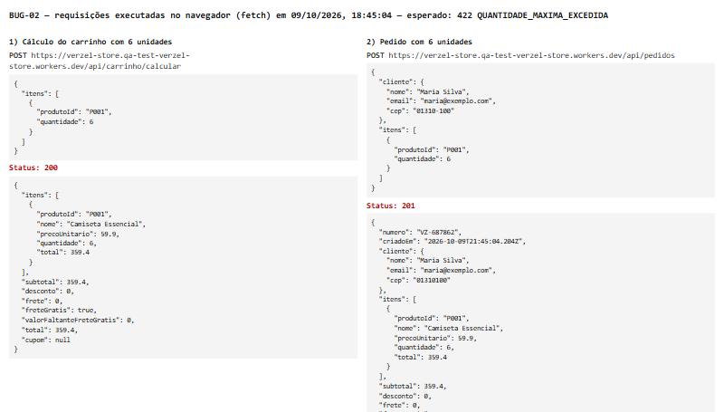
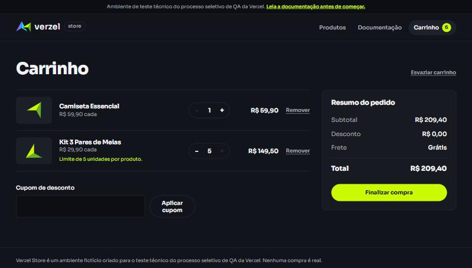

# BUG-02 — API aceita mais de 5 unidades do mesmo produto no cálculo e no pedido

| Campo | Valor |
|---|---|
| **Card** | VZS-142 — Cupom de desconto e frete grátis (versão 2.3.0) |
| **Severidade** | Média |
| **Prioridade** | Alta |
| **Componente** | API: `POST /api/carrinho/calcular` e `POST /api/pedidos` |
| **Critério violado** | CA10: "Cada produto pode ter no máximo 5 unidades por pedido. A regra vale para a interface e para a API." |
| **Cenário de teste** | CT09 ([03-quantidade.feature](../cenarios/03-quantidade.feature)) |
| **Ambiente** | https://verzel-store.qa-test-verzel-store.workers.dev/api |
| **Data** | 09/10/2026 |
| **Status** | Aberto |

## Resumo

A interface respeita o limite de 5 unidades: o botão de aumentar é desabilitado e aparece o aviso "Limite de 5 unidades por produto.". A API, porém, não valida esse limite:
- o cálculo do carrinho responde 200 com 6 ou até 99 unidades;
- a criação de pedido responde **201 e gera número de pedido** com 6 unidades.

O erro documentado para esse caso (`422 QUANTIDADE_MAXIMA_EXCEDIDA`) nunca é retornado.

## Pré-condições

Nenhuma. A API não guarda estado.

## Passos para reproduzir

1. Enviar a requisição abaixo para o cálculo do carrinho:

```bash
curl -X POST https://verzel-store.qa-test-verzel-store.workers.dev/api/carrinho/calcular \
  -H "Content-Type: application/json" \
  -d '{"itens":[{"produtoId":"P001","quantidade":6}]}'
```

2. Enviar a requisição abaixo para a criação de pedido:

```bash
curl -X POST https://verzel-store.qa-test-verzel-store.workers.dev/api/pedidos \
  -H "Content-Type: application/json" \
  -d '{"cliente":{"nome":"Maria Silva","email":"maria@exemplo.com","cep":"01310-100"},"itens":[{"produtoId":"P001","quantidade":6}]}'
```

## Resultado esperado

Nas duas rotas, status **422** com o erro da tabela de códigos da documentação:

```json
{
  "erro": {
    "codigo": "QUANTIDADE_MAXIMA_EXCEDIDA",
    "mensagem": "...",
    "campo": "itens[0].quantidade"
  }
}
```

E nenhum pedido deve ser gerado.

## Resultado obtido

| Requisição | Quantidade | Status obtido | Resultado |
|---|---|---|---|
| `POST /api/carrinho/calcular` (controle) | 5 | 200 | ✅ Correto |
| `POST /api/carrinho/calcular` | 6 | **200**, subtotal 359.4 | ❌ Falha |
| `POST /api/carrinho/calcular` | 99 | **200**, subtotal 5930.1 | ❌ Falha |
| `POST /api/pedidos` | 6 | **201**, pedido `VZ-007243` gerado | ❌ Falha |

## Evidências

**Requisições com 6 unidades executadas no navegador:** o cálculo responde 200 e o pedido responde 201, com número gerado.



**Contraponto na interface:** o botão "+" fica desabilitado em 5 unidades e aparece o aviso de limite. Ou seja, a regra existe só na tela.



Respostas completas da API, com data e hora da execução:

| Arquivo | Conteúdo |
|---|---|
| [BUG-02_controle_calcular_qtd-5.json](../evidencias/api/BUG-02_controle_calcular_qtd-5.json) | Controle com 5 unidades (correto) |
| [BUG-02_calcular_qtd-6.json](../evidencias/api/BUG-02_calcular_qtd-6.json) | Cálculo aceito com 6 unidades |
| [BUG-02_calcular_qtd-99.json](../evidencias/api/BUG-02_calcular_qtd-99.json) | Cálculo aceito com 99 unidades |
| [BUG-02_pedido_qtd-6.json](../evidencias/api/BUG-02_pedido_qtd-6.json) | Pedido confirmado com 6 unidades |

## Justificativa da severidade e prioridade

- **Severidade média:** um cliente comum, usando a loja pela interface, não consegue passar de 5 unidades, então o impacto direto é limitado.
- **Prioridade alta:**
  - o critério diz explicitamente que a regra vale também para a API;
  - a validação no servidor é a única garantia real, já que a interface pode ser contornada por qualquer requisição direta ou integração;
  - o defeito permite **confirmar pedidos** fora da regra.

## Possível causa

As outras validações de quantidade funcionam: zero, negativo, decimal e texto retornam `QUANTIDADE_INVALIDA`. Então a validação de máximo parece estar ausente no servidor, e o limite existe só na interface.
